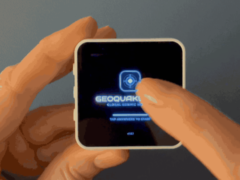

# GeoQuake Lite

Live earthquakes on a desk AMOLED.



https://github.com/user-attachments/assets/1f840d83-4249-49ae-b4f5-600dd7d08b8b

[Watch the 1-minute video](https://bulutsolutions.github.io/geoquake-lite/geoquake-lite-demo.mp4)

## What it does

- Shows the latest earthquakes worldwide from the USGS live feed (the newest 100), checking every 5 to 30 minutes.
- Pinch to zoom, drag to pan. The world map (Natural Earth) is built into the firmware: nothing to download.
- A quake list with magnitude, place, depth and time; tap a dot on the map for its details.
- Minimum magnitude filter, sound alerts, brightness, night dimming and time zone in Settings.
- Talks only to the USGS feed and public time servers: no account, no server of ours, no tracking.

## What you need

- A Waveshare ESP32-S3-Touch-AMOLED-2.16 board.
- A USB-C cable that carries data (not a charge-only cable).

## Install

Open the browser installer at **https://bulutsolutions.github.io/geoquake-lite/** in Chrome or Edge on a
desktop computer, connect the board over USB-C, and follow the page. The
installer also asks for your Wi-Fi details right after flashing.

> **Warning:** installing erases everything on the board: any other firmware
> and its settings, saved Wi-Fi networks, and files in its flash.
> Back up anything you want to keep before you start.

## Wi-Fi

After flashing, use **Connect to Wi-Fi** in the installer to join your network.

To change Wi-Fi later, choose **Settings > Forget Wi-Fi** on the device, then
open the installer page again and choose **Connect to Wi-Fi**.

## Build from source

The project builds with [PlatformIO](https://platformio.org/):

```bash
pio run -e geoquake_lite                         # firmware
pio run -e geoquake_lite -t buildfs              # LittleFS image from data/
```

Flash the four images at these offsets:

| Image | Offset |
| --- | --- |
| `bootloader.bin` | `0x0` |
| `partitions.bin` | `0x8000` |
| `firmware.bin` | `0x10000` |
| `littlefs.bin` | `0x410000` |

The LittleFS image contains the map pack at
`/GeoQuakeLite/tiles/core.pak`.

## Map

The map is drawn from [Natural Earth](https://www.naturalearthdata.com/) data
(public domain). The generator in `tools/tile_generator` renders the tiles and
packs the core set; use `--version 2` when packing:

```bash
python3 tools/tile_generator/pack_core_tiles.py <tiles dir> <output.pak> --version 2
```

## Credits

Built with LVGL, Arduino-ESP32, ESP-IDF, the GFX Library for Arduino,
ArduinoJson, XPowersLib, SensorLib, and improv-wifi. Fonts are subsets of
Montserrat, Bruno Ace SC, DSEG7 Classic, Orbitron, and Material Symbols.
Earthquake data comes from the USGS. See `THIRD_PARTY_NOTICES.md` and
`licenses/` for the full notices.

## License

GeoQuake Lite is released under the MIT license. See `LICENSE`. Third-party
components keep their own licenses; see `THIRD_PARTY_NOTICES.md`.

## Contact

Bugs and ideas: GitHub Issues. Other questions: hello@handeos.com.

More apps for this board: https://handeos.com
